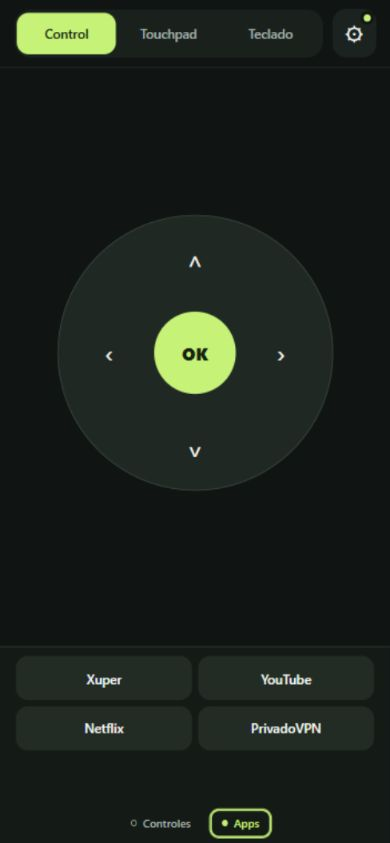
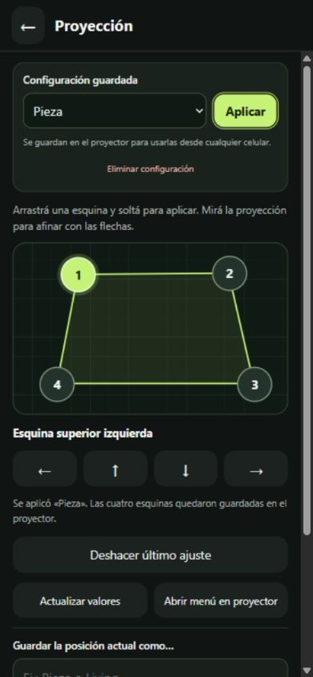

# HY Remote

Controlá un proyector Android desde el navegador de tu celular, por Wi-Fi.

**[Descargar la APK](https://github.com/Aleervdnr/hy-remote/releases/latest/download/HY-Remote.apk)** · [Instalación paso a paso](docs/INSTALACION.md)

## Qué hace

- Control con flechas, OK, Inicio, Atrás, menú, volumen y reproducción.
- Touchpad con cursor en el proyector, clic, pulsación larga y scroll con dos dedos.
- Teclado desde el celular, con tildes y ñ en campos compatibles.
- Accesos a las apps instaladas: elegí tus favoritos y abrilos desde el control.
- Bloque inferior con dos páginas: controles y aplicaciones.
- Ajuste de las cuatro esquinas de proyección y hasta 12 configuraciones con nombre, como «Pieza» o «Living».
- QR generado por cada instalación y sesión del navegador persistente.
- Servicio local que vuelve al encender el proyector, si el firmware permite su inicio.

La APK se instala **solo en el proyector**.

 

## Compatibilidad

Probado en **HY300 Pro con Android 11**, firmware `UI_Veng.projector.20241211.154238`, con 1 GB de RAM. El mínimo declarado de la APK es Android 8, pero eso no significa que cualquier dispositivo sea compatible: necesita ADB local autorizado en el puerto 5555.

Los proyectores vendidos como HY300 Pro pueden llevar firmwares diferentes. Algunos requieren una configuración inicial desde una computadora para habilitar la conexión local. Las funciones de proyección verifican el modelo y firmware; en otras versiones muestran un aviso y no modifican la calibración.

Los perfiles guardan las ocho coordenadas de las esquinas; no incluyen zoom, orientación ni enfoque. Un cambio grande entre perfiles tarda más porque se aplica mediante el menú original en pasos acotados.

## Instalación rápida

1. Descargá `HY-Remote.apk` desde Releases y abrila en el proyector, por ejemplo desde un pendrive.
2. Abrí HY Remote, habilitá la depuración y aceptá la autorización del control interno.
3. Conectá el celular al mismo Wi-Fi y escaneá el QR del proyector.
4. Para el touchpad, autorizá «Permitir cursor en pantalla». Para escribir, elegí «Usar teclado del celular».

La [guía completa](docs/INSTALACION.md) explica los permisos y las limitaciones de instalación. La APK no incluye cuentas, VPN ni aplicaciones de streaming.

## Cómo funciona

La APK ejecuta un servidor HTTP local en el puerto 8767. La página del celular envía órdenes autenticadas al proyector. Un cliente ADB local autorizado transmite las pulsaciones y gestos; el teclado usa un método de entrada de Android.

La clave se genera en el primer inicio y se guarda en el almacenamiento privado de la app. El QR y el enlace de cada proyector conceden control a quien pueda acceder desde esa red: no son enlaces para publicar. La comunicación es HTTP local. El código y la APK de este repositorio no incluyen las claves, direcciones, cuentas ni perfiles de una instalación personal.

Los perfiles de proyección se guardan en el proyector y se comparten entre los celulares vinculados. Las operaciones específicas del firmware usan un adaptador local que valida la identidad de la app que lo llama y finaliza tras un período de inactividad.

## Compilar en Windows

Necesitás **JDK 17**, el SDK de Android con **platforms;android-30** y **build-tools;35.0.0**, y PowerShell. No hay dependencias de Gradle ni servicios externos para compilar.

```powershell
.\build.ps1 -JdkHome $env:JAVA_HOME `
  -AndroidJar "$env:ANDROID_HOME\platforms\android-30\android.jar" `
  -BuildTools "$env:ANDROID_HOME\build-tools\35.0.0"
```

La APK compilada queda en `build/HY-Remote.apk`. La primera vez se crea una firma local en `.signing/`, fuera de Git; el script solicita una contraseña si no definiste `HY_REMOTE_KEYSTORE_PASSWORD`. Conservá tu firma para actualizar tus propias compilaciones.

La firma de las APK publicadas se mantiene privada. Una compilación con una firma diferente no puede actualizar directamente la APK de Releases instalada; Android exigirá desinstalarla antes, lo que elimina sus ajustes locales.

Para comprobar los gestos del frontend con Node.js:

```sh
node tests/touch-gestures.cjs
```

## Créditos

La generación de códigos QR utiliza la biblioteca Java de **Project Nayuki**, bajo licencia MIT. La revisión y el aviso completo están en [AVISOS-TERCEROS.txt](AVISOS-TERCEROS.txt).

Proyecto independiente; no está afiliado al fabricante del proyector ni a las aplicaciones que pueda abrir.
